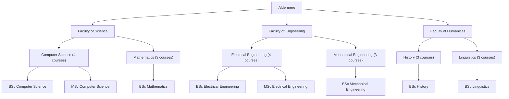

# Aldermere University

A fictional university used as a controlled world for multi-agent experiments.

- Location: Aldermere, Northshore
- Website: https://www.aldermere.edu
- Mail domain: aldermere.edu
- MAS mailbox: assistant@aldermere.edu

## Counts

- People: 50
- Accounts: 51
- Mailboxes: 51
- Faculties: 3
- Departments: 6
- Programs: 8
- Courses: 20
- Enrollments: 94
- Research projects: 10
- Documents: 100
- Emails: 500
- Email threads: 204
- Events: 50
- Buildings: 3
- Rooms: 30

## Organization

Courses, exams, offices, and events point at rooms in the generated campus. The chart above is built from the rows in this database.
