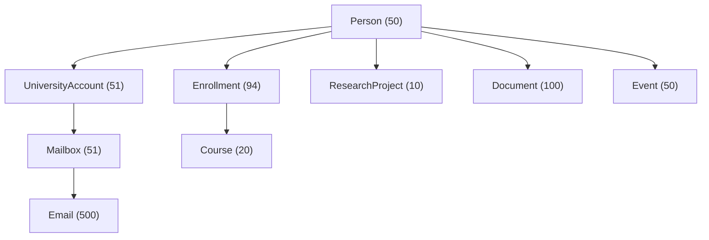

# Relationships in Aldermere University

The synthetic university is the world. A later multi-agent system, benchmark, and external mailbox provider stay outside it.

People act through a university account and a mailbox. The centralized assistant is a service principal with mailbox assistant@aldermere.edu. Its messages use that mailbox as the sender. Text inside an email is not proof of who sent it; the sender is the mailbox row.

Permissions are rows evaluated by `checkPermission`. There is no rule that an administrator can do everything. The default is deny.

Structured facts live in tables (enrollment, membership, exam time, room). Unstructured facts live in document text and email bodies, including the late-submission policy and labeled security fixtures. Security fixtures stay ordinary content. They are marked with a security case and the handling `UNTRUSTED_CONTENT`.

